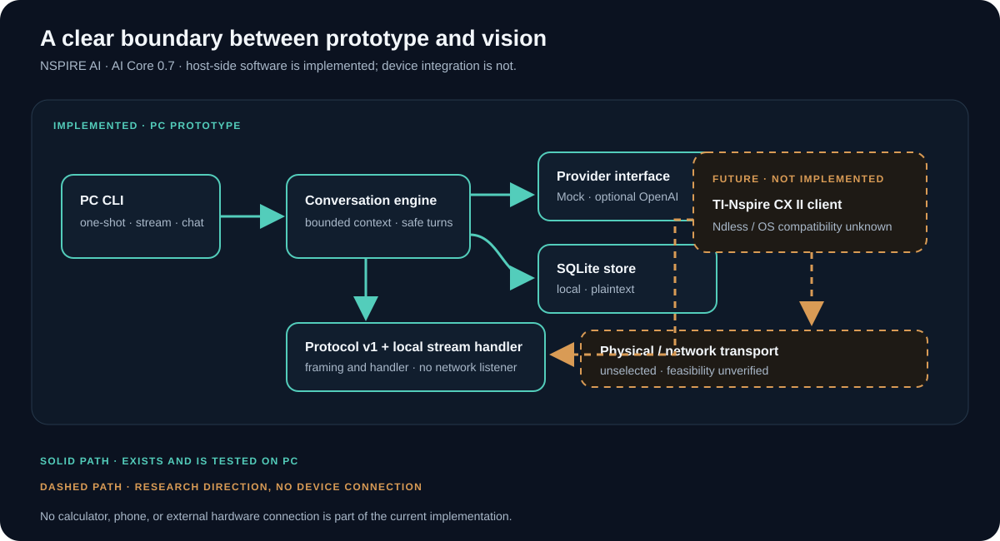

<h1 align="center">NSPIRE AI</h1>

<p align="center">
  
</p>

<p align="center"><strong>A software-first exploration of intelligent computing for the TI‑Nspire.</strong><br>
Today: a working PC prototype. Long term: a calculator interface, if hardware and software feasibility checks support it.</p>

<p align="center">
  <a href="ROADMAP.md"></a>
  
  
</p>

> **Current scope:** AI Core 0.7 is a host-side Python prototype. It offers a mock provider by default, an optional OpenAI adapter, guided persistent chat, bounded streaming, SQLite storage, a versioned message protocol, and a local stream handler. It does **not** connect to a TI‑Nspire, phone, network adapter, or external hardware.

## One project, two horizons

The calculator is the long-term interface idea. The implemented work is the software foundation on a PC. The diagram marks that boundary explicitly: the solid path is implemented; the dashed path is a research direction.

<p align="center">
  
</p>

## Run the prototype

Requires Python 3.13 or newer. From the repository root, run in PowerShell:

```powershell
cd software/pc-prototype
py -3.13 -m venv .venv
.\.venv\Scripts\Activate.ps1
python -m pip install -e ".[dev]"
nspire-ai "Explain what a provider interface is"
nspire-ai --stream "Explain what a provider interface is"
nspire-ai --chat
python -m pytest
```

The default mock provider works offline. OpenAI is opt-in and needs `OPENAI_API_KEY`; selected conversation context is sent to the configured service and may incur charges. Persistent conversation history is stored locally as plaintext. See the [PC prototype guide](software/pc-prototype/README.md) for configuration, privacy, backup, and failure behavior.

## What is real today

| Implemented on the PC | Still future work / unverified |
| --- | --- |
| Provider-neutral AI core and optional OpenAI Responses API adapter | TI‑Nspire client or calculator-side application |
| Guided chat, streaming, and local SQLite conversations | A physical or network connection to a calculator |
| Protocol v1 and bounded local stream framing/handler | Ndless API and target OS compatibility |
| Offline automated tests; current run: **150 passed, 1 skipped** | Hardware, power, thermal, electrical and latency feasibility |

The skipped test checks POSIX permission bits, which are unavailable on Windows. This count was freshly verified on Python 3.13.17 with pytest 9.2.0; it supersedes the 149-pass result recorded for the earlier AI Core 0.7 run. No live OpenAI request was made.

## Follow the engineering

[Engineering Journey](docs/ENGINEERING_JOURNEY.md) presents evidence-backed case studies with their implementation commits, tests, and known boundaries.

## Project map

- [Roadmap](ROADMAP.md) — completed PC milestones and open research.
- [Architecture](docs/ARCHITECTURE.md) — current implementation, future direction, and constraints.
- [Development log](docs/DEVELOPMENT_LOG.md) — decisions, verification, and limitations.
- [Protocol v1](docs/PROTOCOL_V1.md) · [Transport Layer 0.1](docs/TRANSPORT_LAYER_V0_1.md) — message contract and local stream framing.
- [Hardware research](docs/HARDWARE_RESEARCH.md) — open feasibility questions and safety constraints.
- [PC prototype guide](software/pc-prototype/README.md) · [Changelog](CHANGELOG.md) · [Contributing](CONTRIBUTING.md).

## Open decisions and limitations

- No calculator integration, device transport, phone integration, GUI, accounts, cloud sync, or school workflows exist.
- A phone hotspot alone cannot give the calculator network capability. A compatible host would still need a supported physical interface and software.
- Ndless compatibility and OS-specific APIs need hands-on verification on the target device.
- OpenAI requests send retained conversation context to the configured service. Local conversation text and backups are plaintext; encryption at rest is not provided.
- Streaming has per-operation and idle-read timeouts, not a total wall-clock deadline. Automatic retries are disabled.
- No software license has been selected. Do not assume the repository code is licensed for reuse.

## Project principles

Validate the software experience on a PC first. Keep the calculator interface, transport, and AI engine replaceable. Publish status only when supported by code, tests, or recorded experiments. Defer hardware purchases and modifications until feasibility is established.
